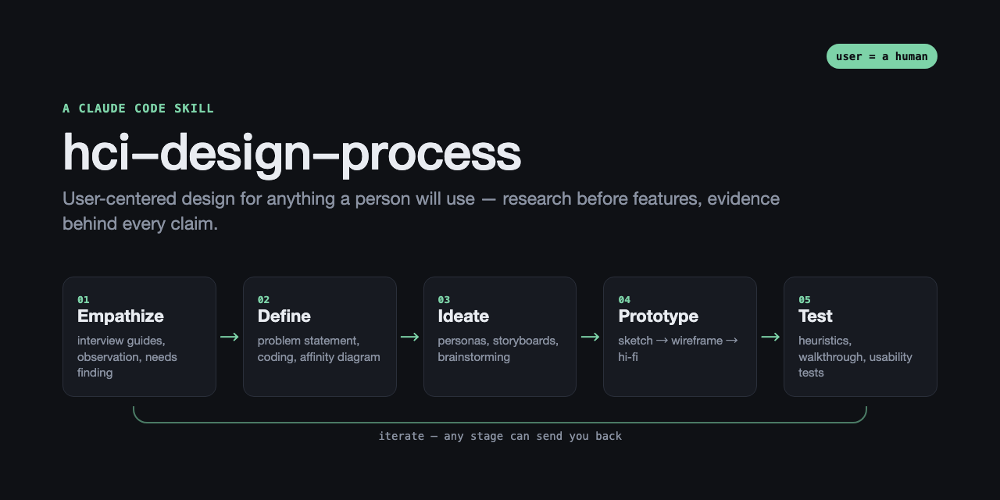

# hci-design-process

A Claude Code skill that makes Claude design the way a UX researcher would. It starts with the people and their problem, defines that problem sharply, and only then sketches, prototypes and tests. Without it, Claude tends to jump straight to a feature list.

## What it changes

- **"How should I start designing this app?"** You get a research plan instead of a feature list. It leads with a problem statement that contains no solution, says who to talk to, and warns against asking people what features they want.
- **"Write our interview guide."** The guide follows interview craft: 3–4 themes taken from the problem statement; intro → warm-up → main body → wrap-up; specific past incidents ("tell me about the last time…"); no leading, yes/no, hypothetical or "design it for me" questions; and it always ends with *"Is there anything we didn't talk about?"*
- **Interview notes in, analysis out.** Claude does emergent coding and builds an affinity diagram whose headers state insights rather than repeating interview questions. It writes composite personas (one primary, the rest secondary) and a storyboard that runs trigger → problem → solution → ending, with emotions.
- **"Users are confused by Y."** Claude frames the issue as a gulf of execution or evaluation, checks existing evidence, proposes a redesign, and writes a usability test plan with goal-phrased tasks, metrics and SUS.
- **Honest evidence.** Every artifact says what it rests on: primary research, existing traces, your own account, or labeled assumptions.

## The process

```
Empathize ──► Define ──────────► Ideate ─────────► Prototype ─────────► Test
users,        problem statement   personas,          sketch → wireframe   heuristics,
interviews,   coding, affinity    storyboards,       → hi-fi; mental      walkthrough,
observation   diagram             brainstorming      models, gulfs        usability test, SUS
   ▲────────────────────── iterate: any stage can send you back ──────────────────┘
```

The process scales to the size of the decision. A new product runs every stage. A new feature gets a lighter pass. A cosmetic tweak skips it entirely. Each stage ends with an exit gate, a concrete check of whether it's done, and the classic mistakes are spelled out: clustering by interview question, a "design suggestions" cluster, one persona per interviewee, storyboards without a problem or without a resolution.

## Install

```bash
git clone https://github.com/StevenLi-phoenix/hci-design-process-skill ~/.claude/skills/hci-design-process
```

Claude Code picks it up automatically. It triggers on design and user-research requests and stays out of plain coding tasks and agent-facing interfaces.

## Evaluated

Measured with `claude plugin eval` on 8 cases (6 should-fire, 2 should-not-fire), 3 runs per arm, Sonnet as judge. Each case compares Claude with the skill against Claude without it:

<!-- EVAL_TABLE -->

## What's inside

| Path | Contents |
|---|---|
| `SKILL.md` | Principles, scaling rules, evidence ladder, five stages with exit gates, hand-offs |
| `references/` | `empathize`, `define`, `ideate`, `prototype`, `test`, `ethics`: methods, rules, examples, pitfalls |
| `templates/` | Problem statement, interview guide, affinity diagram, persona, storyboard, usability test plan |
| `evals/` | The eval suite above (`claude plugin eval . --no-publish`) |

## Companion skill

[`aci-design-process`](https://github.com/StevenLi-phoenix/aci-design-process-skill) applies the same process to interfaces whose user is an AI agent: MCP tools, CLIs, APIs, skills and prompts. If a product has both kinds of users, this skill's tasks and storyboards become that one's eval tasks.

## Sources

The methods follow a university HCI course built on *Interaction Design: Beyond Human-Computer Interaction* (Preece, Rogers & Sharp, 6th ed., Wiley). They are paraphrased and extended with ISO 9241-11, Nielsen's heuristics and severity scale, Norman's design principles, Shneiderman's direct manipulation, Holtzblatt's contextual inquiry, Glaser & Strauss's grounded theory, and the SUS questionnaire.

## License

MIT
